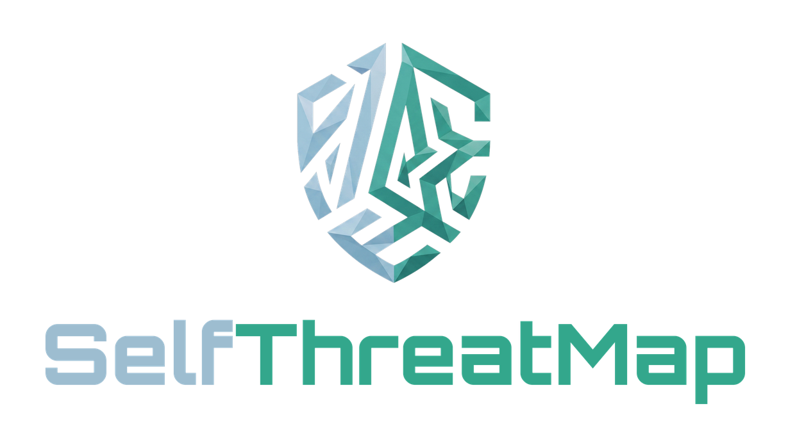
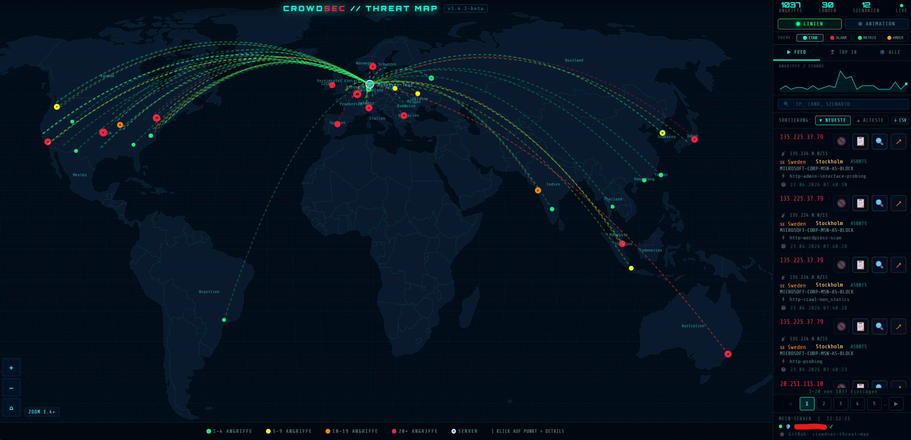

<div align="center">



**Live attack map straight from your local CrowdSec database.**<br>
*Live-Angriffskarte direkt aus deiner lokalen CrowdSec-Datenbank.*


[](LICENSE)


[](https://github.com/s3lfcod3r/selfthreatmap/pkgs/container/selfthreatmap)

**[🇬🇧 English](#-english) · [🇩🇪 Deutsch](#-deutsch)**

📰 **What's new / Neuigkeiten** → [CHANGELOG.md](CHANGELOG.md)

</div>

---

<a id="-english"></a>

## 🇬🇧 English

**SelfThreatMap** shows the attacks from your local **CrowdSec** database live on a world map — all attack points are visible on load, city names appear when you zoom in. It is a dashboard on top of an existing CrowdSec installation; it does **not** detect or block anything itself (that stays CrowdSec's job), but it can lift bans with one click.

Part of the **Self** family (SelfMailer, SelfStream, SelfArchiver, SelfDashboard …) — same design system, same deploy style (GHCR → Unraid). Built on the original CrowdSec Threat Map.

> **TL;DR** — world map with 30+ flight-path styles · 50+ profiles · search, ban status & unban · dynamic self-IP whitelist · login + optional 2FA · 12 languages · works offline



### 📑 Table of contents

[Features](#en-features) · [Flight-path styles](#en-styles) · [Architecture](#en-architecture) · [Quick start](#en-quick-start) · [Unraid](#en-unraid) · [Configuration](#en-configuration) · [Security](#en-security) · [Tech stack](#en-tech-stack) · [Development](#en-development) · [Roadmap](#en-roadmap)

<a id="en-features"></a>

### ✨ Features

**🌍 Map**
- **Interactive world map** with animated attack paths (D3.js) — all attack points visible on load
- **30+ flight-path styles** — rocket (default), comet, laser, particle stream, arcs, impact rings and more
- **50+ one-click profiles** — presets bundling style + theme + animation + density + mode (e.g. "All attacks (console)", "Static heatmap", "Comet rain", "Matrix mode", "Brute-force hunt"); your pick is **remembered across reloads**
- **Attack-origin views** — "Countries" opens a ranked list of every country (+ top cities) you were attacked from; the "ORIGINS" toggle plots every origin as a point, coloured by count, with collision-free labels (country names zoomed out, city names zoomed in), live
- **Auto-fit zoom**, city names visible all the way in (up to 25×)
- **Replay loop** — play the whole time window on an endless loop (24H / 48H, 0.5× / 1× / 2×)
- **10 colour themes** — Cyan, Alarm, Matrix, Amber, Arctic, Cyber, Inferno, Mono, Synth, Ocean

**📊 Feed & actions**
- **Real-time search** by IP, country, city, scenario, ASN; scenario and country filters as chips
- **Ban status & one-click unban** straight from the dashboard (deletes decision and alert)
- **Sparkline**, top 10, live feed with pagination and **CSV export**
- IP lookups (CrowdSec CTI, Shodan, Censys, RIPE, RIPEstat, Criminal IP) from the context menu
- **Dynamic IP whitelist** — whitelists your own changing public IP every 15 min (no self-ban)

**🎨 Platform**
- **12 European languages** (DE, EN, FR, ES, IT, PT, NL, PL, SV, DA, CS, EL) with in-app flag dropdown, remembered in the browser · fully responsive
- **Fully self-contained** — d3 and world-map data bundled locally; works offline, no external CDN calls
- **Self design** — dark teal/cyan theme from the shared Self brand kit

<a id="en-styles"></a>

### 🚀 Flight-path styles

The signature feature: how each attack travels from its origin to your server. Pick from **30+ animated styles** under **Settings → Flight-path style** (default: **Rocket**), with a live preview. Implemented in [`assets/js/rocket-styles.js`](assets/js/rocket-styles.js) — easy to extend.

| Group | Styles |
|---|---|
| Rockets | Rocket · Twin rocket · Arrow · Data packet |
| Comets & trails | Comet · Comet + sparks · Meteor · Fading trail · Gradient trail · Mist trail · Spark trail |
| Beams & lasers | Laser pulse · Constant beam · Neon tube · Lightning · Plasma orb |
| Particles & dots | Particle stream · Tracer · Bead chain · Fireflies · Inward pull · Echo ghosts · Double helix |
| Lines & special | Clean arc · Twin line · Morse dash · Sine wave · Pulse ring · Impact ring · Hologram |
| Classic (legacy) | Classic · Console (dashed arcs) · Minimal |

<a id="en-architecture"></a>

### 🧭 Architecture

```text
Browser ──▶ nginx :8080 ──┬─ /auth/*, login, setup, settings ──▶ auth.py (/config/auth.json)
                          ├─ / (dashboard, protected via auth_request)
                          └─ /metrics, /unban, /whitelist-status
                                          │
                                          ▼
                          crowdsec_exporter.py (127.0.0.1:9456)
                             │ reads crowdsec.db + GeoLite2-City.mmdb (read-only)
                             │ writes whitelist YAML (postoverflows)
                             └─ docker exec crowdsec cscli … (unban, restart)
```

<a id="en-quick-start"></a>

### 🚀 Quick start (Docker)

```bash
docker run -d \
  --name selfthreatmap \
  --restart unless-stopped \
  -p 8080:8080 \
  -v /path/to/selfthreatmap/config:/config \
  -v /path/to/crowdsec/data:/crowdsec/data:ro \
  -v /path/to/crowdsec/postoverflows:/crowdsec/postoverflows \
  -v /var/run/docker.sock:/var/run/docker.sock:ro \
  --group-add 999 \
  -e SERVER_LAT=52.5200 \
  -e SERVER_LON=13.4050 \
  -e SERVER_NAME=Berlin \
  -e LANGUAGE=en \
  ghcr.io/s3lfcod3r/selfthreatmap:latest
```

Open `http://<host>:8080` → create your admin **user + password**. Two-factor (TOTP) is optional — enable it afterwards under **Settings** by scanning the QR code (Google Authenticator / SelfAuthenticator). Compose file: [`docker/docker-compose.yml`](docker/docker-compose.yml).

> **💡 Tip:** coordinates — right-click in [Google Maps](https://maps.google.com) → "What's here?". CrowdSec data path: `docker inspect crowdsec | grep -A5 "Mounts"`.

> **💡 GeoIP / city names:** without a GeoIP database only country points are shown. Download [MaxMind GeoLite2-City](https://www.maxmind.com/en/geolite2/signup) for free, put `GeoLite2-City.mmdb` into the CrowdSec data folder and restart the container.

<a id="en-unraid"></a>

### 📦 Unraid

Unraid → **Apps** → search `selfthreatmap` → install → fill in `SERVER_LAT` / `SERVER_LON` and the CrowdSec data path → **Apply**. Or add the template from
`https://raw.githubusercontent.com/s3lfcod3r/selfthreatmap/main/unraid/selfthreatmap.xml`.
Dashboard: `http://YOUR-UNRAID-IP:8080`.

> **⚠️ Mount `/config`:** account, 2FA and session key live in `/config/auth.json` — without this volume your user is gone after an update.

<a id="en-configuration"></a>

### ⚙️ Configuration

Environment variables (no common prefix).

| Variable | Required | Default | Purpose |
|---|---|---|---|
| `SERVER_LAT` / `SERVER_LON` | ✅ | `0.0` | Your server coordinates (the map's home point) |
| `SERVER_NAME` | – | `MeinServer` | Display name of the home marker |
| `LANGUAGE` | – | `de` | Default UI language: `de` or `en` (12 languages in the app) |
| `CROWDSEC_CONTAINER` | – | `crowdsec` | Name of the CrowdSec container |
| `CROWDSEC_DB_PATH` | – | `/crowdsec/data/crowdsec.db` | CrowdSec SQLite database |
| `CROWDSEC_MMDB_PATH` | – | `/crowdsec/data/GeoLite2-City.mmdb` | GeoIP database (city names) |
| `CACHE_TTL` / `DAYS_BACK` | – | `60` / `365` | Metric cache (s) and history window (days) |
| `WHITELIST_ENABLED` | – | `true` | Dynamic self-IP whitelist |
| `WHITELIST_FILE` | – | `/crowdsec/postoverflows/s01-whitelist/my-whitelist.yaml` | Whitelist file |
| `WHITELIST_INTERVAL` | – | `900` | Whitelist check interval (s) |
| `CROWDSEC_RESTART_WAIT` / `CROWDSEC_RESTART_COOLDOWN` | – | `15` / `300` | Wait after and minimum gap between CrowdSec restarts (s) |
| `AUTH_ENABLED` | – | `true` | Login (+ optional 2FA) for the whole dashboard |
| `COOKIE_SECURE` | – | `false` | `true` when served over HTTPS only |
| `CONFIG_DIR` | – | `/config` | Where account + 2FA data is stored |
| `SESSION_TTL` | – | `86400` | Session lifetime (s) |
| `LOGIN_MAX_FAILS` / `LOGIN_LOCKOUT_SECONDS` | – | `5` / `900` | Lockout after failed logins |

<a id="en-security"></a>

### 🛡️ Security

- **Login + optional 2FA (TOTP)** for the whole dashboard via nginx `auth_request`; first account is created in the browser — **no secrets in env vars**
- Signed session cookie (`HttpOnly`, `SameSite=Strict`); login rate limit and **lockout** after 5 failures (15 min)
- **Unban fails closed** — only with a valid session; rate-limited; IPs validated
- Exporter listens **only on `127.0.0.1`**; no CORS `*`; **CSP**, `Permissions-Policy`, `X-Frame-Options: DENY`
- All backend fields are **escaped** in feed, tooltips and panels (XSS fixed); generic error messages instead of stack traces
- No external CDN — everything bundled locally
- **Deliberate trade-offs** (documented): the dashboard can lift CrowdSec bans via the **Docker socket**, which effectively means root on the host (`:ro` does not prevent that) — treat port **8080 like an admin UI**, keep it on LAN/VPN, put it behind HTTPS (`COOKIE_SECURE=true`) if reachable from outside; a [docker-socket-proxy](https://github.com/Tecnativa/docker-socket-proxy) with only the needed rights is the harder option, or drop the socket if you don't need unban

Security update history → [CHANGELOG.md](CHANGELOG.md) (entries marked 🔒).

<a id="en-tech-stack"></a>

### 🧱 Tech stack

| Part | Tech |
|---|---|
| Backend | Python 3.12 (stdlib) · `crowdsec_exporter.py` · `auth.py` · own MMDB reader |
| Web | HTML · JavaScript · D3.js · topojson (bundled) · Self brand tokens |
| Proxy | nginx (`auth_request`, rate limits, gzip) |
| Deploy | Docker (`python:3.12-alpine`) · GHCR · Unraid |

<a id="en-development"></a>

### 🛠️ Development

```bash
docker build -f docker/Dockerfile -t selfthreatmap .
docker compose -f docker/docker-compose.yml up -d
```

Style engine: [`assets/js/rocket-styles.js`](assets/js/rocket-styles.js) · profiles: `assets/js/profiles.js` · origins: `assets/js/origins.js` · translations: `assets/i18n/`.

<a id="en-roadmap"></a>

### 🗺️ Roadmap

- [x] 30+ flight-path styles, 50+ profiles, 10 themes, replay loop
- [x] Attack-origin views, 12 languages, offline bundle
- [x] Login + optional 2FA, security hardening
- [x] Fast MMDB reader with IP cache and background refresh
- [ ] Test the 2.9.1 UI in the browser

<p align="right"><a href="#-english">⬆ back to top</a></p>

---

<a id="-deutsch"></a>

## 🇩🇪 Deutsch

**SelfThreatMap** zeigt Angriffe aus deiner lokalen **CrowdSec**-Datenbank live auf einer Weltkarte — beim Aufruf sind alle Angriffspunkte sichtbar, beim Reinzoomen erscheinen Stadtnamen. Es ist ein Dashboard auf einer bestehenden CrowdSec-Installation; selbst erkennt oder blockt es **nichts** (das bleibt Aufgabe von CrowdSec), es kann aber Bans per Klick aufheben.

Teil der **Self**-Familie (SelfMailer, SelfStream, SelfArchiver, SelfDashboard …) — gleiches Design-System, gleicher Deploy-Stil (GHCR → Unraid). Basiert auf der ursprünglichen CrowdSec Threat Map.

> **Kurz** — Weltkarte mit 30+ Bahn-Stilen · 50+ Profile · Suche, Ban-Status & Unban · dynamische Whitelist der eigenen IP · Login + optionale 2FA · 12 Sprachen · läuft offline


### 📑 Inhaltsverzeichnis

[Funktionen](#de-funktionen) · [Bahn-Stile](#de-stile) · [Architektur](#de-architektur) · [Schnellstart](#de-schnellstart) · [Unraid](#de-unraid) · [Konfiguration](#de-konfiguration) · [Sicherheit](#de-sicherheit) · [Tech-Stack](#de-tech-stack) · [Entwicklung](#de-entwicklung) · [Roadmap](#de-roadmap)

<a id="de-funktionen"></a>

### ✨ Funktionen

**🌍 Karte**
- **Interaktive Weltkarte** mit animierten Angriffsbahnen (D3.js) — beim Laden alle Angriffspunkte sichtbar
- **Über 30 Bahn-Stile** — Rakete (Standard), Komet, Laser, Partikel-Strom, Bögen, Einschlag-Ringe u. v. m.
- **50+ Ein-Klick-Profile** — Voreinstellungen, die Stil + Theme + Animation + Dichte + Modus bündeln (z. B. „Alle Angriffe (Console)“, „Heatmap pur“, „Kometen-Regen“, „Matrix-Modus“, „Brute-Force-Jagd“); die Wahl **bleibt nach dem Neuladen erhalten**
- **Herkünfte-Ansichten** — „LÄNDER“ öffnet die Rangliste aller Länder (+ Top-Städte), aus denen du angegriffen wurdest; der Schalter „HERKÜNFTE“ zeigt jeden Herkunftsort als Punkt, nach Anzahl gefärbt, mit überlappungsfreien Beschriftungen (Länder herausgezoomt, Städte beim Reinzoomen), live
- **Auto-Fit-Zoom**, Stadtnamen bis ganz nah sichtbar (bis 25×)
- **Replay-Schleife** — das ganze Zeitfenster als Endlosschleife abspielen (24H / 48H, 0,5× / 1× / 2×)
- **10 Farbthemen** — Cyan, Alarm, Matrix, Amber, Arctic, Cyber, Inferno, Mono, Synth, Ocean

**📊 Feed & Aktionen**
- **Echtzeit-Suche** nach IP, Land, Stadt, Szenario, ASN; Szenario- und Länderfilter als Chips
- **Ban-Status & Unban per Klick** direkt aus dem Dashboard (löscht Decision und Alert)
- **Sparkline**, Top 10, Live-Feed mit Seiten und **CSV-Export**
- IP-Abfragen (CrowdSec CTI, Shodan, Censys, RIPE, RIPEstat, Criminal IP) aus dem Kontextmenü
- **Dynamische IP-Whitelist** — setzt deine eigene wechselnde öffentliche IP alle 15 Min auf die Whitelist (kein Selbst-Ban)

**🎨 Plattform**
- **12 europäische Sprachen** (DE, EN, FR, ES, IT, PT, NL, PL, SV, DA, CS, EL) mit Flaggen-Auswahl in der App, im Browser gemerkt · voll responsive
- **Komplett eigenständig** — d3 und Weltkarten-Daten lokal mitgeliefert; läuft offline, keine externen CDN-Aufrufe
- **Self-Design** — dunkles Teal/Cyan-Theme aus dem gemeinsamen Self-Brand-Kit

<a id="de-stile"></a>

### 🚀 Bahn-Stile

Das Herzstück: wie jeder Angriff von der Quelle zu deinem Server fliegt. **Über 30 animierte Stile** unter **Einstellungen → Bahn-Stil** (Standard: **Rakete**), mit Live-Vorschau. Code: [`assets/js/rocket-styles.js`](assets/js/rocket-styles.js) — leicht erweiterbar.

| Gruppe | Stile |
|---|---|
| Raketen | Rakete · Doppel-Rakete · Pfeil · Datenpaket |
| Kometen & Schweife | Komet · Komet + Funken · Meteor · Schweif-Fade · Verlauf-Trail · Nebel-Trail · Funken-Schweif |
| Strahlen & Laser | Laser-Puls · Laser konstant · Neon-Tube · Blitz · Plasma-Kugel |
| Partikel & Punkte | Partikel-Strom · Tracer (MG) · Punkt-Kette · Glühwürmchen · Sog / Implosion · Echo-Geister · Doppelhelix |
| Linien & Spezial | Reiner Bogen · Doppellinie · Morse-Strich · Sinus-Welle · Impuls-Welle · Einschlag-Ring · Hologramm |
| Klassisch (alt) | Klassisch · Console (gestrichelte Bögen) · Minimal |

<a id="de-architektur"></a>

### 🧭 Architektur

```text
Browser ──▶ nginx :8080 ──┬─ /auth/*, Login, Einrichtung, Einstellungen ──▶ auth.py (/config/auth.json)
                          ├─ / (Dashboard, geschützt per auth_request)
                          └─ /metrics, /unban, /whitelist-status
                                          │
                                          ▼
                          crowdsec_exporter.py (127.0.0.1:9456)
                             │ liest crowdsec.db + GeoLite2-City.mmdb (nur lesend)
                             │ schreibt Whitelist-YAML (postoverflows)
                             └─ docker exec crowdsec cscli … (Unban, Neustart)
```

<a id="de-schnellstart"></a>

### 🚀 Schnellstart (Docker)

```bash
docker run -d \
  --name selfthreatmap \
  --restart unless-stopped \
  -p 8080:8080 \
  -v /pfad/zu/selfthreatmap/config:/config \
  -v /pfad/zu/crowdsec/data:/crowdsec/data:ro \
  -v /pfad/zu/crowdsec/postoverflows:/crowdsec/postoverflows \
  -v /var/run/docker.sock:/var/run/docker.sock:ro \
  --group-add 999 \
  -e SERVER_LAT=52.5200 \
  -e SERVER_LON=13.4050 \
  -e SERVER_NAME=Berlin \
  -e LANGUAGE=de \
  ghcr.io/s3lfcod3r/selfthreatmap:latest
```

`http://<host>:8080` öffnen → Admin-**Benutzer + Passwort** anlegen. Zwei-Faktor (TOTP) ist optional — danach unter **Einstellungen** per QR-Code aktivieren (Google Authenticator / SelfAuthenticator). Compose-Datei: [`docker/docker-compose.yml`](docker/docker-compose.yml).

> **💡 Tipp:** Koordinaten — Rechtsklick in [Google Maps](https://maps.google.com) → „Was ist hier?“. CrowdSec-Datenpfad: `docker inspect crowdsec | grep -A5 "Mounts"`.

> **💡 GeoIP / Stadtnamen:** Ohne GeoIP-Datenbank werden nur Länderpunkte angezeigt. [MaxMind GeoLite2-City](https://www.maxmind.com/en/geolite2/signup) kostenlos laden, `GeoLite2-City.mmdb` in den CrowdSec-Datenordner legen, Container neu starten.

<a id="de-unraid"></a>

### 📦 Unraid

Unraid → **Apps** → `selfthreatmap` suchen → installieren → `SERVER_LAT` / `SERVER_LON` und den CrowdSec-Datenpfad eintragen → **Anwenden**. Oder die Vorlage von
`https://raw.githubusercontent.com/s3lfcod3r/selfthreatmap/main/unraid/selfthreatmap.xml`
hinzufügen. Dashboard: `http://DEINE-UNRAID-IP:8080`.

> **⚠️ `/config` einbinden:** Konto, 2FA und Sitzungsschlüssel liegen in `/config/auth.json` — ohne dieses Volume ist dein Benutzer nach einem Update weg.

<a id="de-konfiguration"></a>

### ⚙️ Konfiguration

Umgebungsvariablen (ohne gemeinsames Präfix).

| Variable | Pflicht | Standard | Zweck |
|---|---|---|---|
| `SERVER_LAT` / `SERVER_LON` | ✅ | `0.0` | Koordinaten deines Servers (Heimatpunkt der Karte) |
| `SERVER_NAME` | – | `MeinServer` | Anzeigename des Heimat-Markers |
| `LANGUAGE` | – | `de` | Standardsprache: `de` oder `en` (12 Sprachen in der App) |
| `CROWDSEC_CONTAINER` | – | `crowdsec` | Name des CrowdSec-Containers |
| `CROWDSEC_DB_PATH` | – | `/crowdsec/data/crowdsec.db` | CrowdSec-SQLite-Datenbank |
| `CROWDSEC_MMDB_PATH` | – | `/crowdsec/data/GeoLite2-City.mmdb` | GeoIP-Datenbank (Stadtnamen) |
| `CACHE_TTL` / `DAYS_BACK` | – | `60` / `365` | Metrik-Cache (s) und Zeitraum (Tage) |
| `WHITELIST_ENABLED` | – | `true` | Dynamische Whitelist der eigenen IP |
| `WHITELIST_FILE` | – | `/crowdsec/postoverflows/s01-whitelist/my-whitelist.yaml` | Whitelist-Datei |
| `WHITELIST_INTERVAL` | – | `900` | Prüfintervall der Whitelist (s) |
| `CROWDSEC_RESTART_WAIT` / `CROWDSEC_RESTART_COOLDOWN` | – | `15` / `300` | Wartezeit nach und Mindestabstand zwischen CrowdSec-Neustarts (s) |
| `AUTH_ENABLED` | – | `true` | Login (+ optionale 2FA) für das ganze Dashboard |
| `COOKIE_SECURE` | – | `false` | `true`, wenn nur über HTTPS erreichbar |
| `CONFIG_DIR` | – | `/config` | Speicherort für Konto + 2FA |
| `SESSION_TTL` | – | `86400` | Gültigkeit der Sitzung (s) |
| `LOGIN_MAX_FAILS` / `LOGIN_LOCKOUT_SECONDS` | – | `5` / `900` | Sperre nach Fehl-Logins |

<a id="de-sicherheit"></a>

### 🛡️ Sicherheit

- **Login + optionale 2FA (TOTP)** für das ganze Dashboard über nginx `auth_request`; das erste Konto wird im Browser angelegt — **keine Geheimnisse in Umgebungsvariablen**
- Signiertes Sitzungs-Cookie (`HttpOnly`, `SameSite=Strict`); Begrenzung der Login-Versuche und **Sperre** nach 5 Fehlversuchen (15 min)
- **Unban nur mit gültiger Sitzung** (sonst gesperrt); mit Durchsatzbegrenzung; IPs werden geprüft
- Exporter lauscht **nur auf `127.0.0.1`**; kein CORS `*`; **CSP**, `Permissions-Policy`, `X-Frame-Options: DENY`
- Alle Backend-Felder werden in Feed, Tooltips und Panels **escaped** (XSS behoben); allgemeine Fehlermeldungen statt Stacktraces
- Kein externes CDN — alles lokal mitgeliefert
- **Bewusste Kompromisse** (dokumentiert): Das Dashboard kann CrowdSec-Bans über den **Docker-Socket** aufheben, was faktisch Root auf dem Host bedeutet (`:ro` verhindert das nicht) — behandle Port **8080 wie eine Admin-Oberfläche**, nur im LAN/VPN nutzen, bei Erreichbarkeit von außen hinter HTTPS legen (`COOKIE_SECURE=true`); härter ist ein [docker-socket-proxy](https://github.com/Tecnativa/docker-socket-proxy) mit nur den nötigen Rechten, oder den Socket weglassen, wenn du kein Unban brauchst

Verlauf der Sicherheitsupdates → [CHANGELOG.md](CHANGELOG.md) (Einträge mit 🔒).

<a id="de-tech-stack"></a>

### 🧱 Tech-Stack

| Teil | Technik |
|---|---|
| Backend | Python 3.12 (Standardbibliothek) · `crowdsec_exporter.py` · `auth.py` · eigener MMDB-Leser |
| Web | HTML · JavaScript · D3.js · topojson (mitgeliefert) · Self-Marken-Tokens |
| Proxy | nginx (`auth_request`, Durchsatzgrenzen, gzip) |
| Deploy | Docker (`python:3.12-alpine`) · GHCR · Unraid |

<a id="de-entwicklung"></a>

### 🛠️ Entwicklung

```bash
docker build -f docker/Dockerfile -t selfthreatmap .
docker compose -f docker/docker-compose.yml up -d
```

Stil-Engine: [`assets/js/rocket-styles.js`](assets/js/rocket-styles.js) · Profile: `assets/js/profiles.js` · Herkünfte: `assets/js/origins.js` · Übersetzungen: `assets/i18n/`.

<a id="de-roadmap"></a>

### 🗺️ Roadmap

- [x] 30+ Bahn-Stile, 50+ Profile, 10 Themes, Replay-Schleife
- [x] Herkünfte-Ansichten, 12 Sprachen, Offline-Paket
- [x] Login + optionale 2FA, Sicherheitshärtung
- [x] Schneller MMDB-Leser mit IP-Cache und Hintergrund-Aktualisierung
- [ ] Oberfläche von 2.9.1 im Browser testen

<p align="right"><a href="#-deutsch">⬆ nach oben</a></p>

---

## ⚖️ Lizenz / License

**🇩🇪 Alle Rechte vorbehalten.** © 2026 s3lfcod3r / SelfCoder

Du darfst die Software **privat und nicht-kommerziell** installieren und benutzen (z. B. im Homelab, über Docker oder Unraid).

**Ohne schriftliche Erlaubnis verboten:** kommerzielle Nutzung · Kopieren · Verändern · Weitergeben · Einbauen in eigene Projekte (auch Closed Source) · Verkaufen.

Details: [LICENSE](LICENSE)

**🇬🇧 All rights reserved.** © 2026 s3lfcod3r / SelfCoder

You may install and use the software **privately and non-commercially** (e.g. in your home lab, via Docker or Unraid).

**Not permitted without written permission:** commercial use · copying · modifying · redistributing · incorporating into other projects (including closed source) · selling.

Details: [LICENSE](LICENSE)

---

---

<div align="center">

**SelfThreatMap** · part of the Self family · Teil der Self-Familie<br>
made with 🗺️ for self-hosting

</div>
